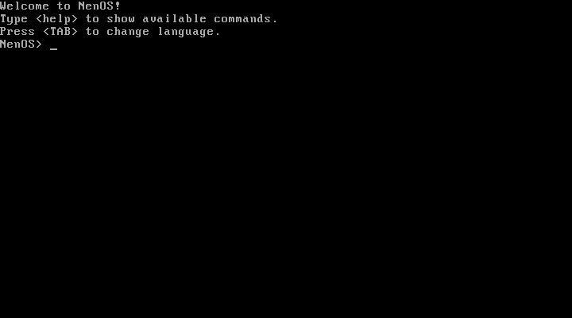

## NenOS
NenOS is an operating system written in assembly language. It runs in real mode (x16) using BIOS interrupts. It has a simple file system and a built‑in assembler.

## Commands
- BUILD &lt;from&gt; &lt;to&gt; - compile to binary.
- CALC &lt;sample&gt; - calculate.
- CLS - clear the screen.
- COPY &lt;from&gt; &lt;to&gt; - copy the document.
- CREATE - create the document.
- DELETE - delete the document.
- DIR - show directory.
- HELP - displaying available commands.
- READ &lt;number&gt; - read the document.
- REBOOT - reboot the computer.
- RUN &lt;number&gt; - run binary.
- TIME - launches the watch app.
- WRITE &lt;number&gt; - write the document.

## Assembler
The built‑in NenOS assembler currently supports the:
 - MOV
 - all 8/16 bit registers and memory
 - INT
 - all interrupts
 - JMP
 - labels
 - CMP
 - all flags
 - INC
 - DEC
 - CALL
 - RET
 - DB
 - DW
 - AND
 - OR
 - ADD
 - SUB
 - XOR
 - CLC
 - STC
 - PUSH
 - POP
 - MUL
 - DIV
 - SHL
 - SHR
 - and the entire syntax of a standard assembler...

This allows you to write simple programs using the WRITE command, compile them using the BUILD command, and run them using the RUN command. Code examples:
```
db 0xb0, 0x21, 0xb4, 0x0e, 0xcd, 0c10
```
```
mov al, "0"

loop:
    mov ah, 0x0e
    int 0x10
    inc al
    cmp al, "9"
    ja done
    jmp loop

done:
```
```
mov si, text

print:
    mov al, [si]
    inc si
    cmp al, 0
    je done
    mov ah, 0x0e
    int 0x10
    jmp print

text: db "Hello, World!", 0

done:
```

## Screenshots

